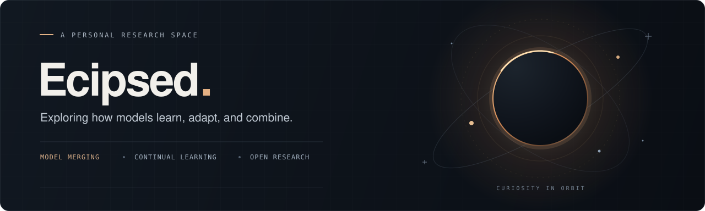
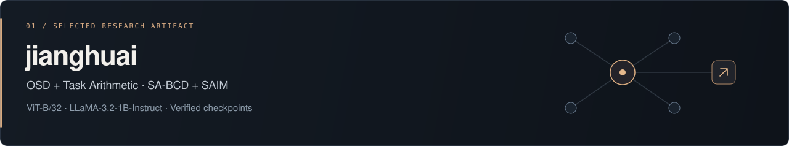

  

  <a href="#research">Research</a> &nbsp; / &nbsp;
  <a href="#selected-work">Selected work</a> &nbsp; / &nbsp;
  <a href="https://github.com/Ecipsed?tab=repositories">Repositories</a> &nbsp; / &nbsp;
  <a href="https://github.com/Ecipsed/jianghuai/releases">Checkpoints</a>

### Hi, I'm Ecipsed.

关注 **模型合并、持续学习与多任务适应**，探索不同任务中的知识如何组合、保留与迁移。

Exploring how models learn, adapt, and combine — through model merging, continual learning, and reproducible experiments.

 

### Research

<table>
  <tr>
    <td width="33%" valign="top">
      01 &nbsp; / &nbsp; COMBINE
      <h3>Model merging</h3>
      
模型合并与任务向量

      
Task arithmetic, weight-space composition, and knowledge across tasks.

    </td>
    <td width="33%" valign="top">
      02 &nbsp; / &nbsp; ADAPT
      <h3>Continual learning</h3>
      
持续学习与多任务适应

      
Sequential fine-tuning, knowledge retention, and adaptation to new tasks.

    </td>
    <td width="33%" valign="top">
      03 &nbsp; / &nbsp; REPRODUCE
      <h3>Reproducible research</h3>
      
从实验到可复现的模型

      
Model checkpoints, provenance, and verifiable research artifacts.

    </td>
  </tr>
</table>

 

### Selected work

**[jianghuai](https://github.com/Ecipsed/jianghuai)** · 模型合并与持续学习的最终 checkpoint

- **Methods** — OSD fine-tuning + Task Arithmetic; SA-BCD fine-tuning + SAIM merging.
- **Models** — ViT-B/32 across eight tasks; LLaMA-3.2-1B-Instruct across seven tasks.
- **Artifacts** — Model weights, SHA-256 manifests, and a Python restoration script.

[Explore the code ↗](https://github.com/Ecipsed/jianghuai) &nbsp; · &nbsp; [Download checkpoints ↗](https://github.com/Ecipsed/jianghuai/releases) &nbsp; · &nbsp; [Restore & verify ↗](https://github.com/Ecipsed/jianghuai/blob/main/restore_checkpoints.py)

 

---

  Learn deeply. Connect ideas. Keep exploring.

